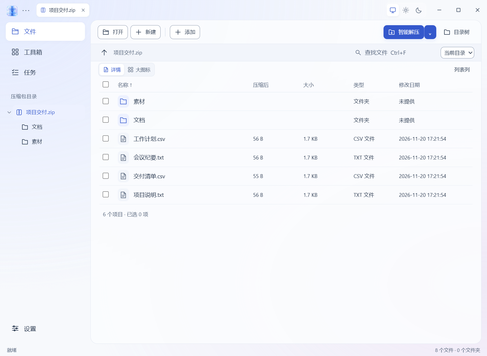

<p align="center"></p>
<h1 align="center">qing-zip</h1>
<p align="center">轻透、顺手的 Windows 本地压缩工具</p>

[下载稳定版](https://github.com/qing-yi-5427/qing-zip/releases/latest) · [历史版本](https://github.com/qing-yi-5427/qing-zip/releases) · [提交问题](https://github.com/qing-yi-5427/qing-zip/issues) · [安全问题私密报告](https://github.com/qing-yi-5427/qing-zip/security/advisories/new)

## 软件截图

以下截图来自实际运行的 Windows 程序。




## 功能

- 毛玻璃界面可跟随 Windows 明暗主题，也可固定浅色或深色。目录树与标签页支持键盘导航。点击路径各级目录可返回上层，搜索范围可选当前目录或整个压缩包。打开「视图 → 平铺视图」可列出当前目录及其子目录中的条目，同名文件显示各自路径。每个标签独立记住这项选择。文件列表支持按名称、大小、压缩后大小、类型和修改日期排序。
- 新建 ZIP、7z 等压缩包时会按来源建议名称。可将多个来源合并，或分别创建并预览各自的输出路径。压缩与完整性检查显示在同一条任务中，完成后可打开压缩包或所在文件夹。
- 支持 ZIP、7z、RAR 等格式解压。向已有压缩包添加文件时可以看到包内目标目录；更新加密条目会核验密码和加密状态。
- 首页可拖入或点击选择文件。普通压缩包直接打开，识别到改名、无后缀或内层压缩包时会填入深度解压窗口，确认后才开始。可手动改为打开压缩包。深度解压支持初始密码、密码续接和全部成功后移入回收站。[使用说明](docs/deep-extraction.md)
- 支持在标签页中打开内层压缩包，修改后逐层保存至外层。内外层密码分别处理；关闭未保存的内层标签会提示保存或放弃，外层被其他程序修改时保留工作副本。
- 从符合条件的 ZIP 或 `.7z.001` 分卷中选取文件时，程序首次校验全包，只暂存选中内容。同次运行中，符合条件的无密码 `.7z.001` 分卷可复用仍被程序保护的完整验证结果，加快重复选取；每次仍重新检查分卷集合、访问权限和包内目录，关闭标签或修改、取消后重新完整校验。分卷支持无加密的非固实 Copy，以及使用 LZMA 或 LZMA2 的固实和非固实 7z，包括符合条件的 AES 加密分卷。
- 7z 可选 ZSTD、Brotli、LZ4 等扩展压缩方法；高级设置提供字典大小、固实压缩与块上限、字长（PPMd 为模型阶数）和文件名加密。仅为支持这些参数的方法启用对应控件。
- 新建 ZIP、7z 和 SFX 时，可分别选择是否保存修改、创建和访问时间，以及是否将压缩包时间设为内容的最新修改时间；这些选择会自动记住。还可开启“保留来源访问时间”，无法完整保留时会列出文件及原因。
- 支持 Brotli、LZ4、LZ5、Lizard、ZSTD 单文件流格式的压缩与解压，也可浏览和提取 WASM、ROMFS、UFS 分区镜像，以及 ZealFS v1 直接镜像中的多级目录。
- 文件校验支持 SHA-2 / SHA-3、BLAKE3、xxHash 等算法，可选择文件夹递归校验，也可混合输入文件和文件夹；支持所选算法、空目录提示和取消任务。
- 文件分割与合并：支持连续编号分块和校验清单，取消或失败时保留源文件；没有清单的第三方分块不能判断末卷是否缺失。
- 工具箱提供 LZMA 引擎基准测试，可选择线程、字典和轮数，查看压缩/解压速度、评分及完整报告，支持取消。
- 打开压缩包后，在「归档维护」中可检查完整性、修复 ZIP、计算文件校验值或预览图片。
- 常见文本预览、图片缩略图与原图打开；支持多选和包内文件复制。
- 包内文件可通过右键“作为压缩包打开”，无需依赖文件后缀；属性页面显示 CRC、压缩方法、加密状态及所选内容的大小；压缩包属性按需显示实际格式、固实状态、卷数和偏移等信息。
- 包内文件可通过右键“外部编辑”交给记事本或指定编辑器，确认后逐层写回；未改动不重写，冲突时保留副本并可另存。
- 在“新建压缩文件”或“添加文件”对话框中，可从资源管理器拖入要打包的文件和文件夹。
- 添加文件的“更新方式”提供添加并替换、更新并添加、仅更新已有和同步所选范围。更新按修改时间与大小判断；同步删除需要单独确认，未选择范围保持不变。
- 解压工具栏提供常用快捷操作和指定位置、深度解压入口。可记住常用解压选项，也可单次解压并回收。任务可收起并继续浏览已打开的标签；完成后可打开实际输出位置，遇到密码或冲突可从任务中调整后重试。
- 工具箱中的密码本支持手动添加、查看、删除和选用密码。默认保存成功解压使用的密码，可在密码本关闭自动保存。保存的密码由当前 Windows 账户保护。
- 支持文件关联、资源管理器右键入口、ZIP 修复和有限范围密码恢复。

## 使用

x64 版面向 Windows 10 2004（19041）及以上版本和 Windows 11。含 `arm64` 的资产是 Windows 11 ARM64 构建，请以对应版本的发布页为准。部分稳定版仅提供 x64。桌面界面需要 Microsoft Edge WebView2 Runtime，可从微软下载缺少的运行时。[WebView2 Runtime](https://developer.microsoft.com/microsoft-edge/webview2/)

- **便携版**：完整解压 `qing-zip-版本-portable.zip`，运行 `qing-zip.exe`，保留同目录中的其他程序文件及 `runtime` 目录。
- **安装版**：运行 `qing-zip-版本-setup.exe`，默认安装到当前用户目录，无需管理员权限。
- **下载校验**：在同一发布页下载对应的 `.sha256`，用 PowerShell 的 `Get-FileHash -Algorithm SHA256 -LiteralPath '下载的文件名'` 计算 SHA-256，并与该校验文件对照。当前稳定版的应用和安装程序未使用 Windows 代码签名。
- `Ctrl+O` 打开，`Ctrl+N` 新建，`Ctrl+E` 解压，`Ctrl+T` 检查完整性，`Ctrl+Tab` 切换标签。
- 文件列表支持方向键、Home / End、Shift 连续选择、空格勾选、回车打开和 Shift+F10 右键菜单。
- 文件列表可选择显示列、调整列顺序与宽度，并记住设置；压缩包目录树支持方向键展开、折叠和跳转，以及 Home / End 定位。
- 文件关联需在 Windows 默认应用设置中确认；Windows 11 的传统右键入口通常位于“显示更多选项”。便携目录移动后，请重新启用右键入口。
- 启用普通文件的右键压缩入口后，可在资源管理器中一次选取 1 至 128 个文件，放入同一个新建压缩包窗口。可执行文件路径、全部文件路径和参数合计最多 32,767 个 UTF-16 码元（含引号、空格和末尾空字符）。超出 Windows 命令行长度上限时，整组选取会报错，可减少文件数后重试。

文件在本机处理。修复只能恢复仍可校验的条目，密码恢复仅尝试指定候选；不保证所有格式、损坏文件或加密方式都能处理。自动回收仅对完整成功解压的已验证单卷格式生效。

拖出包内文件时保持按住鼠标，文件准备好后可交给资源管理器复制。在准备期间松开鼠标或按 Esc 可取消此次拖出。x64 发行版已在真实资源管理器窗口中验证同时拖出文件和文件夹。

外部编辑目前一次处理一个文件。请先在编辑器中保存，再在“编辑 → 外部编辑会话”确认写回或结束。结束后再修改文件不会自动写回；由于外部编辑器可能把文件交给其他窗口，结束会话后工作副本保留在 `%LOCALAPPDATA%\qing-zip\EditedFiles`，重启后可从“编辑 → 保留的编辑副本”定位或另存。该目录不随预览缓存清理。

## 构建

需要 Rust stable 的 MSVC 工具链、Visual Studio C++ Build Tools 与 Windows SDK、Python 3.10+，以及 NSIS 3.11+（构建安装版时使用）。前端测试需要 Node.js 22+。

```powershell
./scripts/build.ps1 -NsisPath "C:/path/to/NSIS/makensis.exe" -OutputDirectory dist/local-x64
```

`obz-gui` 是 Tauri 界面，`obz-rs` 是归档核心和 `obz.exe` 命令行工具。x64 构建按清单校验并打包第三方运行时，生成同版本的便携包、安装程序、引擎源码和 SHA-256 文件。引擎源码包需要已缓存的上游归档或联网下载。提交改动前可运行本地回归。[贡献与测试](CONTRIBUTING.md) · [Windows CI](https://github.com/qing-yi-5427/qing-zip/actions/workflows/windows-ci.yml)

## 许可

项目原创代码使用 [MIT License](LICENSE)。第三方组件遵循各自许可，详见 [第三方声明](licenses/THIRD-PARTY-NOTICES.txt)；NanaZip、7-Zip、嵌入式 Python 和 ZPAQ 的许可与对应源码信息随包提供。

归档引擎采用 NanaZip 7.0.1882.0（7-Zip 核心 26.05），保留官方 7-Zip 26.06 作为兼容后端。原始组件许可和对应源码地址随包提供，Release 中的 `qing-zip-版本-engine-sources.zip` 提供确切版本的源码。
