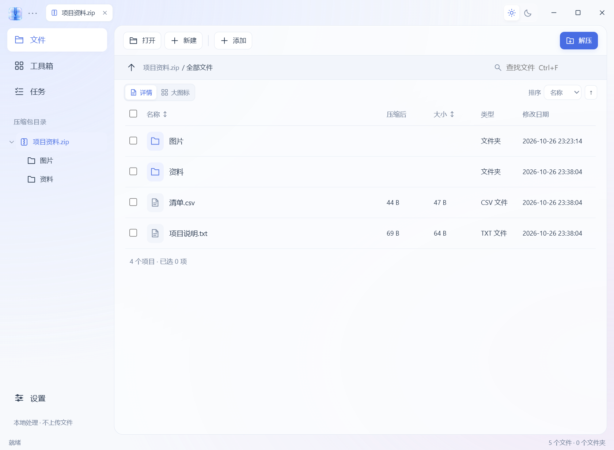
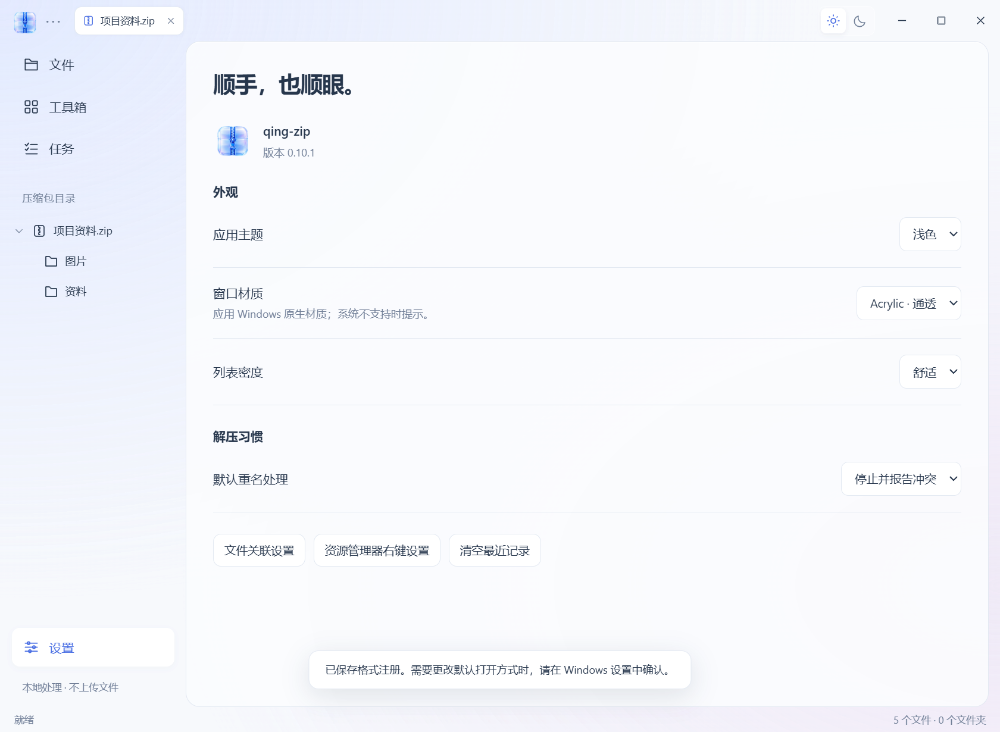

<p align="center"></p>
<h1 align="center">qing-zip</h1>
<p align="center">轻透、顺手的 Windows 本地压缩工具</p>

[下载最新版](https://github.com/qing-yi-5427/qing-zip/releases/latest) · [提交问题](https://github.com/qing-yi-5427/qing-zip/issues)

## 软件截图

以下截图来自实际运行的 Windows 程序。




## 功能

- 毛玻璃界面、浅深色主题、目录树和多标签浏览。
- ZIP / 7z 等格式压缩，ZIP / 7z / RAR 等格式解压；支持加密、分卷和完整性检查。
- 常见文本预览、图片缩略图与原图打开；支持多选和包内文件复制。
- 解压偏好自动记忆：智能解压、成功后回收原包、打开目标文件夹、关闭窗口。
- 文件关联与资源管理器右键入口；ZIP 修复、密码管理和有限范围密码恢复。

## 使用

支持 Windows 10 / 11 x64，需要 Microsoft Edge WebView2 Runtime。

- **便携版**：完整解压 `qing-zip-版本-portable.zip`，运行 `qing-zip.exe`，保留旁边的 `runtime` 目录。
- **安装版**：运行 `qing-zip-版本-setup.exe`，默认安装到当前用户目录，无需管理员权限。
- `Ctrl+O` 打开，`Ctrl+N` 新建，`Ctrl+E` 解压，`Ctrl+T` 检查完整性，`Ctrl+Tab` 切换标签。
- 文件关联需在 Windows 默认应用设置中确认；Windows 11 的传统右键入口通常位于“显示更多选项”。便携目录移动后，请重新启用右键入口。

文件在本机处理。修复只能恢复仍可校验的条目，密码恢复仅尝试指定候选；不保证所有格式、损坏文件或加密方式都能处理。自动回收仅对完整成功解压的已验证单卷格式生效。

包内文件拖出采用先准备临时文件、再复制到目标的方式；大文件准备时需保持按住鼠标。本版本的原生跨窗口拖放仍需更多实机验证。

## 构建

需要 Rust stable、Visual Studio C++ Build Tools、Python 3，以及 NSIS 3.11+（构建安装版时使用）。

```powershell
./scripts/build.ps1 -NsisPath "C:/path/to/NSIS/makensis.exe"
```

输出在 `dist/`。`obz-gui` 是 Tauri 界面，`obz-rs` 是归档核心和 `obz.exe` 命令行工具。第三方运行时随 `runtime/` 提供，构建缓存和研究资料不进入发行包。

## 许可

项目原创代码使用 [MIT License](LICENSE)。第三方组件遵循各自许可，详见 [第三方声明](licenses/THIRD-PARTY-NOTICES.txt)；7-Zip、嵌入式 Python 和 ZPAQ 的许可与对应源码信息随包提供。
