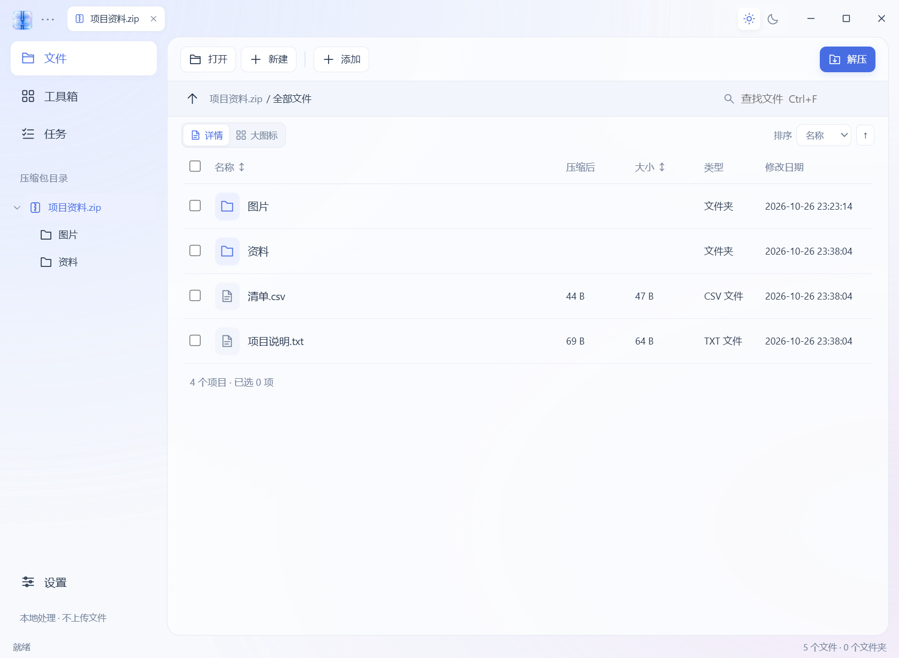
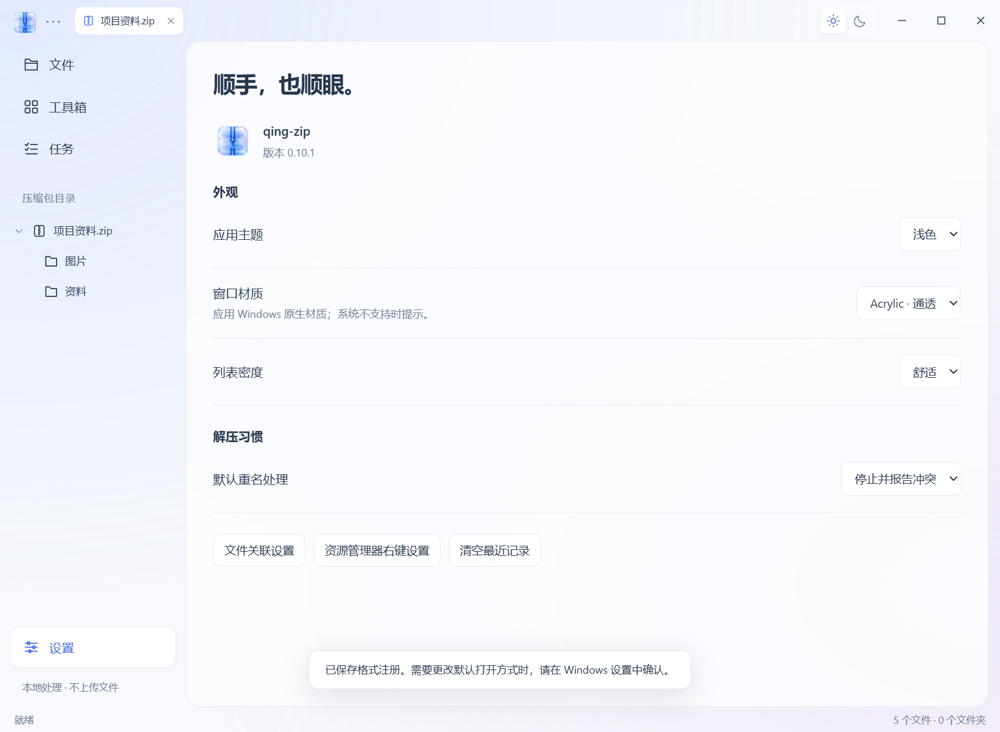

<p align="center"></p>
<h1 align="center">qing-zip</h1>
<p align="center">轻透、顺手的 Windows 本地压缩工具</p>

[下载 0.11.5 试用版](https://github.com/qing-yi-5427/qing-zip/releases/tag/v0.11.5) · [稳定版](https://github.com/qing-yi-5427/qing-zip/releases/latest) · [提交问题](https://github.com/qing-yi-5427/qing-zip/issues)

## 软件截图

以下截图来自实际运行的 Windows 程序。




## 功能

- 毛玻璃界面、浅深色主题、目录树和多标签浏览。文件列表支持按名称、大小、压缩后大小、类型和修改日期排序。
- ZIP / 7z 等格式压缩，ZIP / 7z / RAR 等格式解压；支持加密、分卷和完整性检查。
- 从符合条件的 ZIP 或 `.7z.001` 分卷中选取文件时，程序校验全包，只暂存选中内容。分卷支持无加密的非固实 Copy，以及使用 LZMA 或 LZMA2 的固实和非固实 7z，包括符合条件的 AES 加密分卷。
- 7z 可选 ZSTD、Brotli、LZ4 等扩展压缩方法；高级设置提供字典大小、固实压缩和文件名加密。
- 支持 Brotli、LZ4、LZ5、Lizard、ZSTD 单文件流格式的压缩与解压，也可浏览和提取 WASM、ROMFS、UFS 分区镜像，以及 ZealFS v1 直接镜像中的多级目录。
- 文件校验支持 SHA-2 / SHA-3、BLAKE3、xxHash 等算法，可一次计算多种校验值。
- 常见文本预览、图片缩略图与原图打开；支持多选和包内文件复制。
- 解压偏好自动记忆：智能解压、成功后回收原包、打开目标文件夹、关闭窗口。
- 文件关联与资源管理器右键入口；ZIP 修复、密码管理和有限范围密码恢复。

## 使用

x64 版支持 Windows 10 2004（19041）及以上版本和 Windows 11。Windows 11 ARM64 设备请选择文件名含 `arm64` 的版本。桌面界面需要 Microsoft Edge WebView2 Runtime。

- **便携版**：完整解压 `qing-zip-版本-portable.zip`，运行 `qing-zip.exe`，保留旁边的 `runtime` 目录。
- **安装版**：运行 `qing-zip-版本-setup.exe`，默认安装到当前用户目录，无需管理员权限。
- `Ctrl+O` 打开，`Ctrl+N` 新建，`Ctrl+E` 解压，`Ctrl+T` 检查完整性，`Ctrl+Tab` 切换标签。
- 文件列表支持方向键、Home / End、Shift 连续选择、空格勾选、回车打开和 Shift+F10 右键菜单。
- 文件关联需在 Windows 默认应用设置中确认；Windows 11 的传统右键入口通常位于“显示更多选项”。便携目录移动后，请重新启用右键入口。
- 启用普通文件的右键压缩入口后，可在资源管理器中一次选取 1 至 128 个文件，放入同一个新建压缩包窗口。可执行文件路径、全部文件路径和参数合计最多 32,767 个 UTF-16 码元（含引号、空格和末尾空字符）。超出 Windows 命令行长度上限时，整组选取会报错，可减少文件数后重试。

文件在本机处理。修复只能恢复仍可校验的条目，密码恢复仅尝试指定候选；不保证所有格式、损坏文件或加密方式都能处理。自动回收仅对完整成功解压的已验证单卷格式生效。

拖出包内文件时保持按住鼠标，文件准备好后可交给资源管理器复制。在准备期间松开鼠标或按 Esc 可取消此次拖出。跨窗口实际操作仍待更多桌面验证。

## 构建

需要 Rust stable、Visual Studio C++ Build Tools、Python 3.10+，以及 NSIS 3.11+（构建安装版时使用）。

```powershell
./scripts/build.ps1 -NsisPath "C:/path/to/NSIS/makensis.exe"
```

输出在 `dist/`。`obz-gui` 是 Tauri 界面，`obz-rs` 是归档核心和 `obz.exe` 命令行工具。第三方运行时随 `runtime/` 提供，构建缓存和研究资料不进入发行包。构建会校验运行时哈希，并生成独立的引擎源码包。

## 许可

项目原创代码使用 [MIT License](LICENSE)。第三方组件遵循各自许可，详见 [第三方声明](licenses/THIRD-PARTY-NOTICES.txt)；NanaZip、7-Zip、嵌入式 Python 和 ZPAQ 的许可与对应源码信息随包提供。

归档引擎采用 NanaZip 7.0.1882.0（7-Zip 核心 26.05），保留官方 7-Zip 26.05 作为兼容后端。原始组件许可和对应源码地址随包提供，Release 中的 `qing-zip-版本-engine-sources.zip` 提供确切版本的源码。
