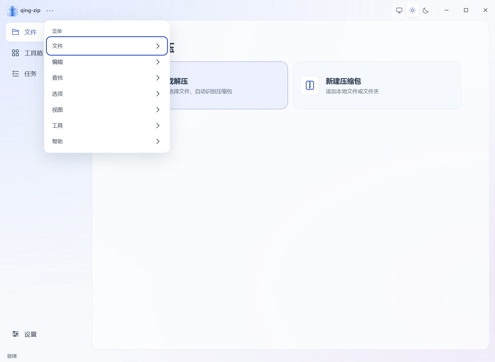
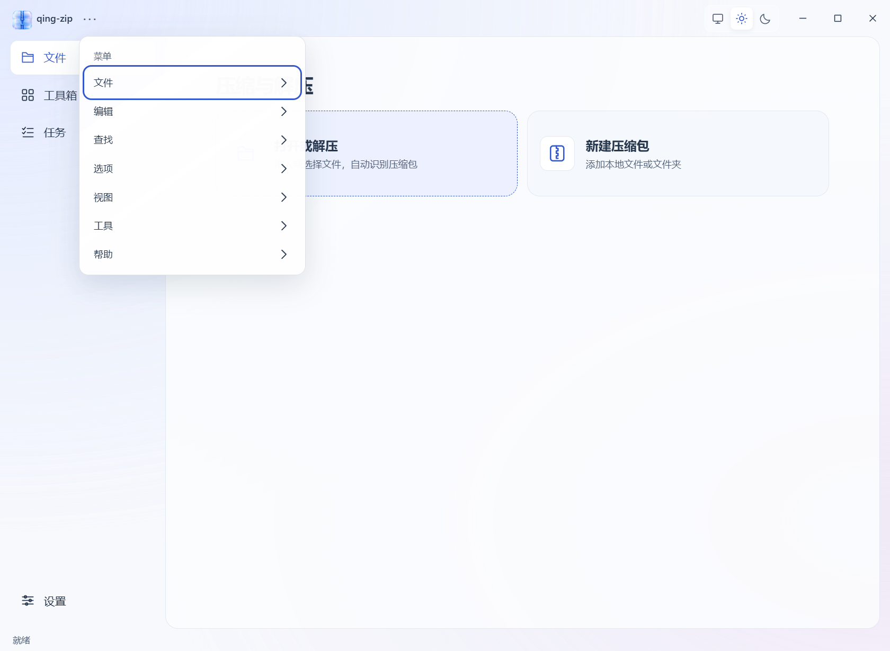
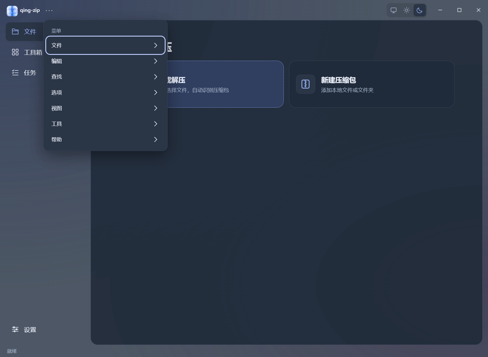
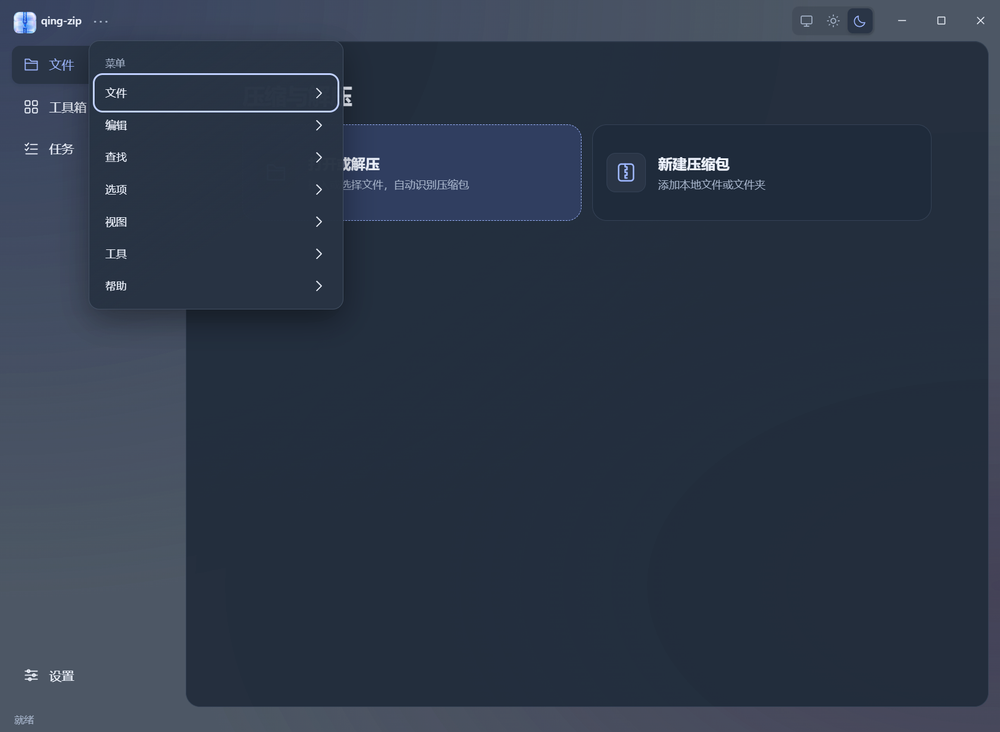

# 主菜单的 Windows 实机对照

基线为本地 0.12.23（`0cc51aa`）。两版都在 Windows 11 x64 build 26300 上编译并实际启动 Tauri 窗口。截图取自该窗口的 WebView2 内容区，临时用户配置中只有空白首页。

| 窗口主题 | 原版 | 候选 |
| --- | --- | --- |
| 浅色 |  |  |
| 深色 |  |  |

原版菜单为不透明控件色。候选在 Acrylic、Mica 窗口上增加高遮盖率的半透明表面、渐变亮边和细轮廓，借用窗口已有的原生材质。真实切换设置中的纯色后恢复不透明背景。WebView2 模拟强制颜色时，应用返回的有效材质为纯色，菜单使用系统画布和边线。[纯色窗口](after-solid.png) · [模拟强制颜色](after-forced.png)

## 可读性、布局和操作

- 实际显示为 150%，视口 1120 × 820 CSS px。两版主菜单均为 285 × 301.83 CSS px，7 项都能访问。Escape 可以关闭，截图可见首项焦点轮廓。
- 对 780 × 620 CSS px 小视口分别模拟设备比例 1 与 2。重新打开菜单后检查非零尺寸和四边界，前后都在视口内。模拟减少动画时同样可操作。物理 100% / 200% 显示器、Windows 高对比度主题和 Windows 10 桌面仍待实机验收。
- 用主题颜色和渐变两端计算保守对比度。分别以黑色或白色作对正文最不利的底层，浅色正文 / 辅文至少约 11.65 / 6.16 比 1，深色至少约 10.80 / 5.77 比 1。数值为颜色合成估算。

## 复跑和原始数据

构建命令为 `cargo build --locked --manifest-path obz-gui/Cargo.toml --release --target-dir target`。先关闭现有 qing-zip 窗口。脚本依赖 Python 的 `websockets`，从实际设置控件切换材质，捕获菜单状态与截图，在每个主题或材质下采集 120 个帧间隔、20 次从合成打开操作到第二个动画帧的耗时。

```powershell
python scripts/fluent-menu-evidence.py --exe <原版exe> --out <新的基线目录>
python scripts/fluent-menu-evidence.py --exe <候选exe> --out <新的候选目录> --candidate
```

两版各采两轮。可逐项复查视口、材质、菜单尺寸、模拟缩放与帧耗时。[原版第一轮](before-1.json) · [原版第二轮](before-2.json) · [候选第一轮](after-1.json) · [候选第二轮](after-2.json) · [启动、内存与两版构建哈希](../../../docs/verification/menu-resource-cost.md)
